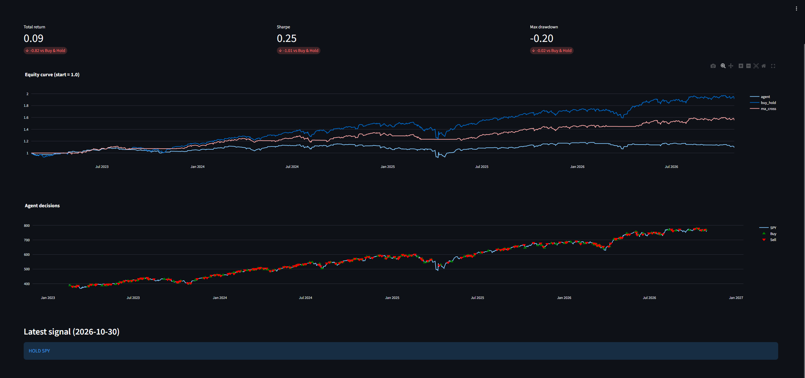
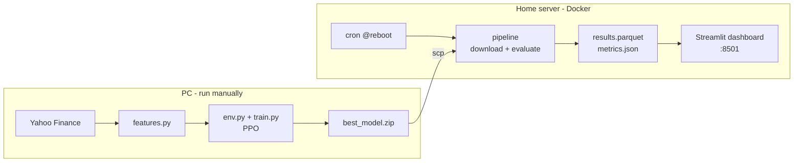

# RL Trading Lab

An end-to-end reinforcement learning prototype: a PPO agent learns to trade the S&P 500 ETF (SPY) on daily data, is evaluated against simple baselines on an untouched test period, and its results are served in a Streamlit dashboard running in Docker on a home server.

> **Educational project only.** This is not investment advice and is not connected to any brokerage account. A model that looks good on historical data usually fails in live markets.



## What it does

1. Downloads daily SPY prices (dividend- and split-adjusted) from Yahoo Finance.
2. Builds 7 normalized market features using only past data.
3. Trains a PPO agent in a custom Gymnasium environment (hold SPY or stay in cash, with a 0.1% cost per trade).
4. Evaluates the agent once on a held-out test period against Buy & Hold and a moving-average crossover.
5. Shows the equity curves, every buy/sell decision and the latest signal in a web dashboard.
6. Refreshes data and signals automatically every time the server boots.

## Architecture



Training is heavy and done once on the PC. The server only runs the trained agent on fresh data (inference), so results stay comparable between runs.

## Results (test period: Jan 2023 – Oct 2026)

| Strategy | Total return | CAGR | Sharpe | Max drawdown |
| --- | --- | --- | --- | --- |
| **PPO agent** | 11.5% | 3.0% | 0.30 | -20.5% |
| Buy & Hold | 94.7% | 19.9% | 1.30 | -18.8% |
| MA crossover (20/50) | 58.0% | 13.2% | 1.27 | -9.7% |

**The agent lost to both baselines on every metric.** This is the honest result of version 1, and it is the most common outcome when trying to beat the market with a model.

## What I learned

- **Overfitting shows up clearly in RL.** Validation reward peaked around 50k training steps and then declined steadily to 300k, while training reward kept improving. Saving the best validation checkpoint (not the last one) was essential.
- **The agent over-trades.** The decisions chart is dense with buy/sell markers. Even at 0.1% per trade, frequent switching plus time spent in cash during a strong bull market (2023–2026) erased most of the return.
- **Baselines matter.** A 40% return sounds impressive until Buy & Hold makes 95% over the same period. A two-line moving-average rule beat the agent by a wide margin.
- **Data leakage is easy to introduce.** Features are normalized with a rolling 252-day window, positions are shifted by one day in the backtest, and the train / validation / test split is by date. A unit test verifies that features computed on truncated data match those computed on the full history.
- **The test set can be used once.** All tuning is done on the validation period (2020–2022, including the COVID crash and the 2022 bear market).

## Data split

| Part | Period | Purpose |
| --- | --- | --- |
| Train | 2011 – 2019 | Agent learns here |
| Validation | 2020 – 2022 | Checkpoint selection and tuning |
| Test | 2023 – today | Final evaluation, used once |

## Tech stack

Python 3.11 · pandas · yfinance · Gymnasium · Stable-Baselines3 (PPO) · PyTorch (CPU) · Streamlit · Plotly · pytest · Docker Compose · cron

## Project structure

```text
src/
  data.py       download and cache prices
  features.py   indicators, rolling normalization, time split
  baseline.py   backtest, metrics, baseline strategies
  env.py        Gymnasium trading environment
  train.py      PPO training with best-checkpoint saving
  evaluate.py   test-period evaluation
  pipeline.py   download + evaluate (used on the server)
app/
  dashboard.py  Streamlit UI
tests/
  test_core.py  leakage, backtest and environment tests
```

## Run it locally (Windows, PowerShell)

```powershell
git clone https://github.com/Muller5258/rl-trading-dashboard.git
cd rl-trading-dashboard
py -3.11 -m venv .venv
.venv\Scripts\Activate.ps1
pip install torch --index-url https://download.pytorch.org/whl/cpu
pip install -r requirements.txt

python -m src.data        # download prices
python -m src.train       # train the agent (~5 min on CPU)
python -m src.evaluate    # evaluate on the test period
streamlit run app/dashboard.py
```

Run the tests:

```powershell
pytest -q
```

## Deploy on a server (Docker)

```bash
git clone https://github.com/Muller5258/rl-trading-dashboard.git
cd rl-trading-dashboard
mkdir -p data models
# copy models/best_model.zip from the training machine, then:
docker compose up -d --build
docker compose run --rm pipeline
```

The dashboard is served at `http://<server-ip>:8501`. To refresh data on every boot, add to `crontab -e`:

```text
@reboot sleep 60 && cd ~/rl-trading-dashboard && docker compose run --rm pipeline >> pipeline.log 2>&1
```

## Next steps

- Penalize trading frequency or drawdown in the reward
- Train with several seeds and report the spread
- Walk-forward evaluation instead of a single split
- Compare PPO with DQN and A2C

## Author

Asaf Muller · [GitHub](https://github.com/Muller5258)